# Raouteri — Huawei E6888-982 Router Monitor

**Keep your router battery, charging state and network speed in view on Windows 11 and Android.**

[العربية](README.md) · English · [Downloads](https://github.com/RioG20/Raouteri/releases/latest)

Raouteri is an independent local-network monitor for the **Huawei E6888-982 Mobile WiFi router**. It is designed for people who want to follow battery and network activity without repeatedly opening the router management screen, especially while working on Windows.

Windows provides a taskbar strip, tray indicators and a draggable island that expands on click. Android provides a persistent monitoring notification, home-screen widget and optional overlay island. Monitoring and overlays can be turned off; the Windows island hides during fullscreen and returns afterwards.

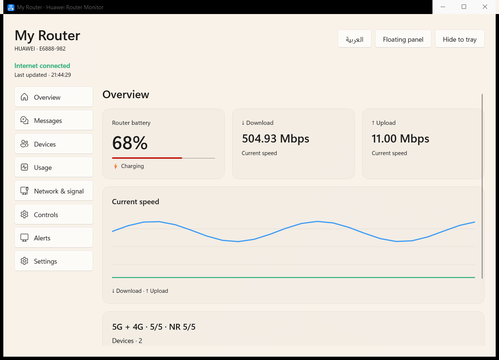

## Download

| Platform | App version | File |
|---|---|---|
| Windows 11 x64 | 1.3.0 | [EXE installer](https://github.com/RioG20/Raouteri/releases/download/v2026.10.16/Raouteri-Windows-Setup-1.3.0.exe) |
| Windows 11 x64 | 1.3.0 | [Complete portable ZIP](https://github.com/RioG20/Raouteri/releases/download/v2026.10.16/Raouteri-Windows-Portable-1.3.0.zip) |
| Android 8.0+ | 1.0.0 | [Signed APK](https://github.com/RioG20/Raouteri/releases/download/v2026.10.16/Raouteri-Android-1.0.0.apk) |

[All releases](https://github.com/RioG20/Raouteri/releases) · [SHA-256 checksums](https://github.com/RioG20/Raouteri/releases/download/v2026.10.16/SHA256SUMS.txt)

This is a **distribution repository** with guides, screenshots and downloadable binaries in Releases. Development source, personal test data and private signing keys are not published here. GitHub's automatic “Source code” archives contain only this repository's documentation and images. Use the EXE, portable ZIP or APK above to install the app.

## New in Windows 1.3.0: accounts and connection profiles

In Settings, add and name a router, enter its management address, username and password, then save or test the connection. Each profile has its own protected password, usage, event history and device aliases. Switching activates the saved profile immediately; save your edits first.

**The implemented connector is Huawei WebUI/SCRAM compatible with the tested device. A configurable username does not automatically add support for every router.** OpenWrt and MikroTik are researched, not enabled. See [compatibility and setup](docs/ROUTER-PROFILES.md). Android remains 1.0.0 without this addition.

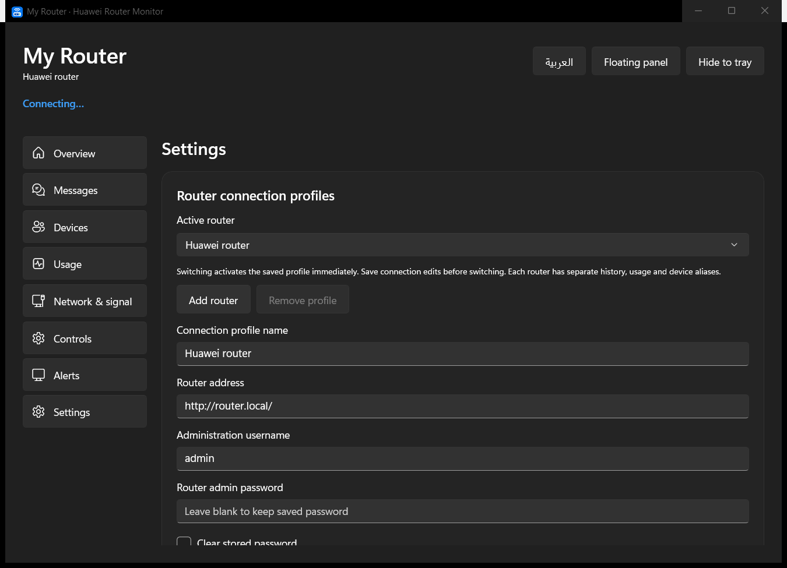

## Tested router and firmware

**This build is specifically tested on the following Huawei E6888-982 configuration. It does not claim compatibility with all Huawei routers.**

| Item | Tested value |
|---|---|
| Router model | Huawei E6888-982 |
| Router firmware | 4.0.0.1(H3568SP6C983) |
| Web interface | WEBUI 4.0.0.1(W11SP6C7001) |
| Hardware | CL4E6888M |
| Customization | E6888-982-CUST 4.0.0.1(C1133) |

Other models or firmware versions require separate testing: authentication, counters, SMS and commands may differ. Windows 1.3.0 and Android 1.0.0 are application versions, not router firmware versions.

## Why Raouteri? How does it relate to AI Life?

[Huawei's official guide](https://consumer.huawei.com/en/support/content/en-us00773202/) describes opening AI Life and selecting the Mobile WiFi device to enter its management screen. Raouteri focuses on **at-a-glance status while you use your computer or phone**: battery, charging, upload/download traffic, connected device count and alerts, with compact displays you can keep visible.

Raouteri is independent and is not affiliated with or endorsed by Huawei. It is not an official AI Life release and does not replace every AI Life feature or router setting. Huawei and model names identify the tested hardware.

## Platform features

| Feature | Windows 1.3.0 | Android 1.0.0 |
|---|---|---|
| Router battery, charging state and alerts | Yes | Yes |
| Upload/download traffic and connected device count | Yes | Yes |
| Persistent compact display | Taskbar strip and tray icons | Monitoring notification and widget |
| Draggable, expandable island | Yes | Yes, with overlay permission |
| Arabic and English interface | Yes | Yes |
| Daily/weekly/monthly/lifetime usage views | Where the data source supports them | Where the data source supports them |
| Read/copy SMS and mark one message as read | Yes | Yes |
| Mark all messages in an inbox as read | Yes, with confirmation and cancellation | Not in 1.0.0 |
| Show/hide device IP addresses | Yes | Not in 1.0.0 |
| Choose a fixed strip speed unit, e.g. Mbps or MB/s | Yes | Not in 1.0.0 |
| Multiple router profiles and editable administration username | Yes, for compatible Huawei interfaces | Not in 1.0.0 |
| Hide battery when no valid reading is available | Yes | Not ported in this update |

Per-device consumption and rates depend on the router's available counters. Zero counters do not establish support; other phones' usage may be unavailable. Wi-Fi link rate is not Internet speed. Displayed traffic rate is current activity, not a maximum-speed test. Local history starts when monitoring begins and cannot retrieve earlier history.

## Install and use on Windows

1. Download and run the EXE installer. Alternatively, extract the entire portable ZIP into a fixed folder and run `HuaweiRouterMonitor.exe` inside it. Copying only that executable is insufficient.
2. Connect to the router network. Enter the management address, normally `http://192.168.8.1/`, administration username (default `admin`) and your **router administration password** in Settings, then save or test the connection.
3. Choose the taskbar strip or floating island. Click to expand, drag the grip to move, or use ↓ to return to the taskbar.
4. Choose strip metrics, speed units, size and transparency in Settings. The Devices page includes a saved Show IP addresses checkbox.
5. Start with Windows is optional. Closing the main window keeps monitoring in the tray; use the tray menu to exit. Windows may initially place icons in its hidden tray menu.

The Windows build is currently unsigned by a commercial publisher certificate. Download from this repository and check SHA-256 if Windows displays an unknown-publisher prompt. Updates preserve local settings.

## Install and use on Android

1. Download and open the APK on your phone. Allow installation from the source you used if Android asks.
2. Connect to the router Wi-Fi. Enter its management address and administration password in the app's Settings.
3. Save and start monitoring. Allow notifications for monitoring status and battery alerts.
4. The island is optional and requires permission to display over other apps. You can also add the Raouteri home-screen widget.
5. If the phone stops background monitoring, review the app's battery settings. Force-stopping the app requires opening it again. Background and overlay behavior varies by manufacturer.

The release APK is signed with the project's key; the private key is not published. Emulator tests and live router connectivity have passed; a physical phone has not yet been tested. See [validation details](docs/VALIDATION.md).

## Screenshots

Screenshots show the actual app interface using isolated demo data. Device names, readings and SMS are samples only. **Personal device addresses, passwords and real messages are absent.**

Windows: connection profiles, island, privacy and SMS

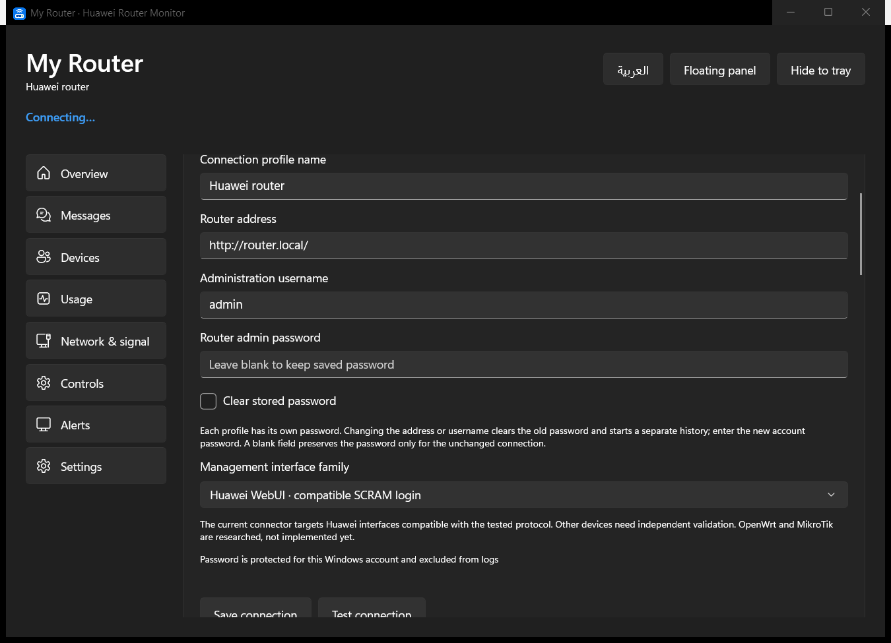

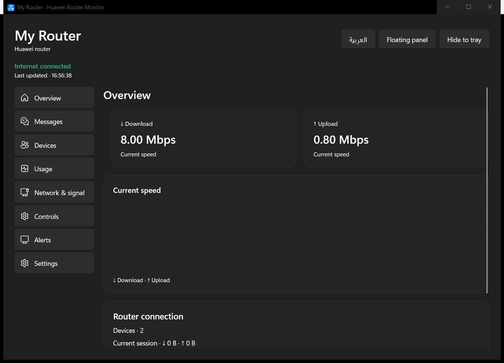

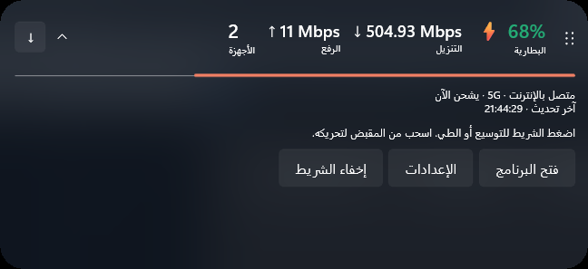

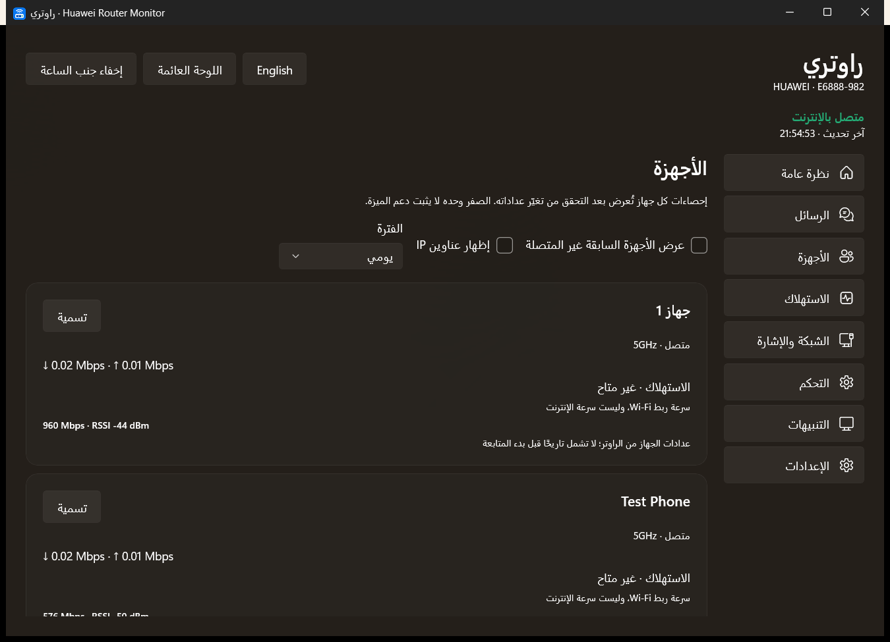

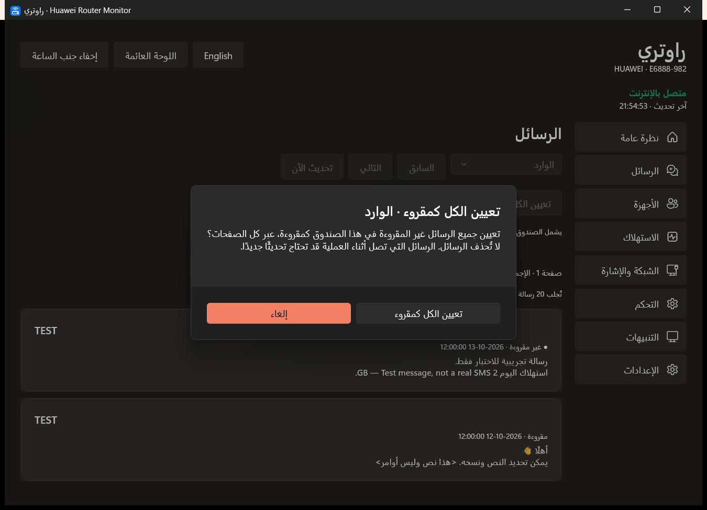

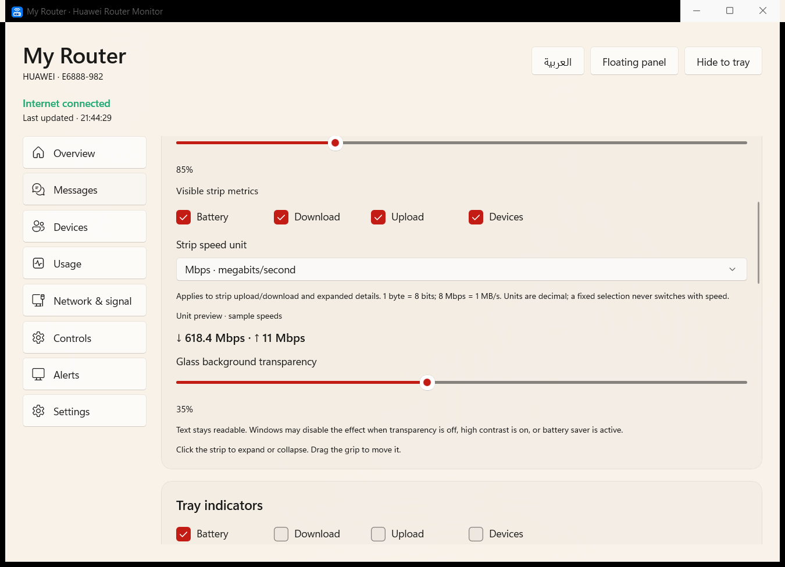

Android: overview, usage, demo SMS and overlay island

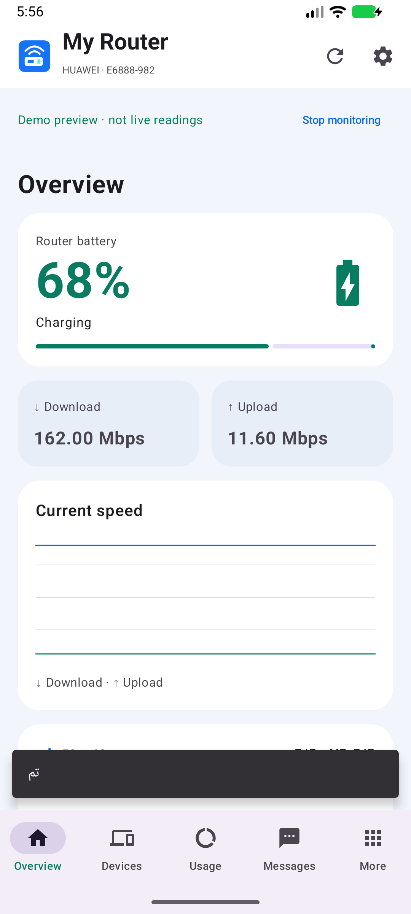
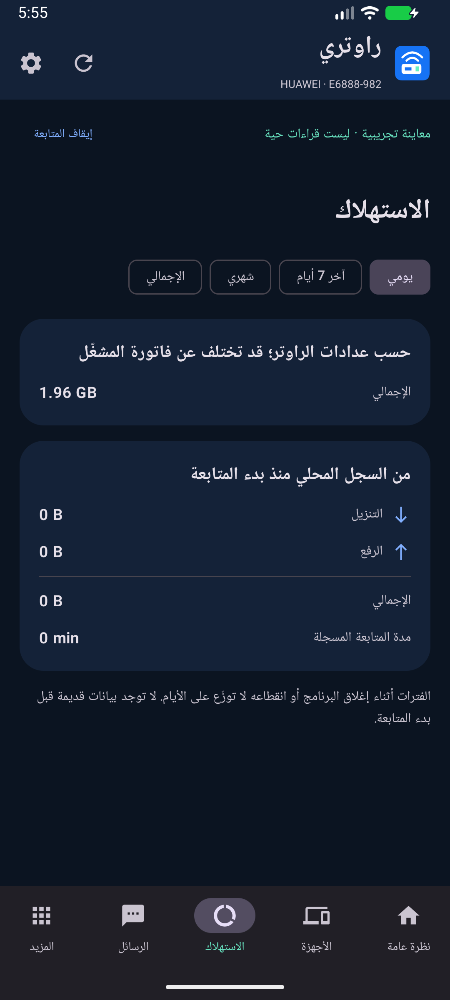
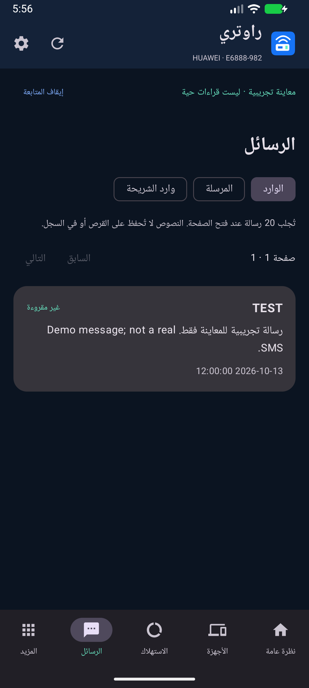

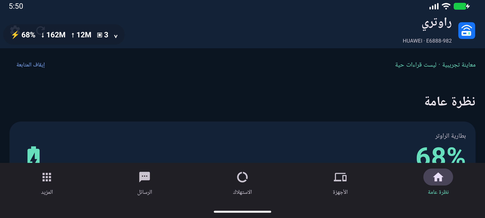

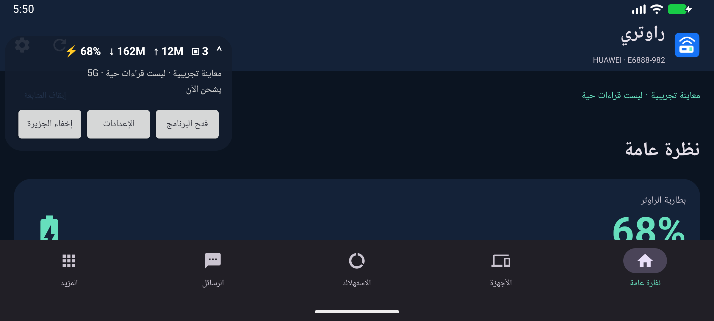

## Privacy and support

The app connects locally to router administration and does not require a cloud account or API key. Passwords are stored using Windows account protection or Android Keystore. The installer contains no preconfigured router password. SMS text is not saved to app history. Local HTTP follows the router's own management protocol.

If connection fails, check router-network access, management address and the **administration password**, which may differ from the Wi-Fi password. Commands such as rebooting or changing message read state require an explicit action.

Report issues through [Issues](https://github.com/RioG20/Raouteri/issues), including platform, app version, model and firmware. Hide IP addresses and device names. Never include passwords, IMEI, IMSI, serial numbers or real SMS contents. Sanitize your own screenshots before uploading them.
