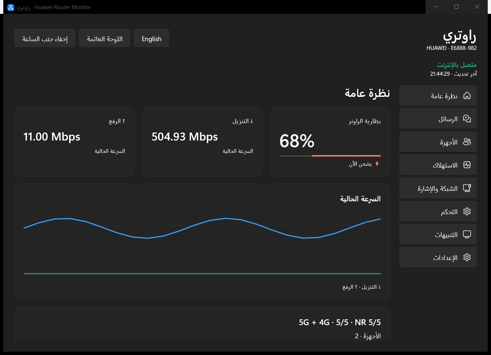
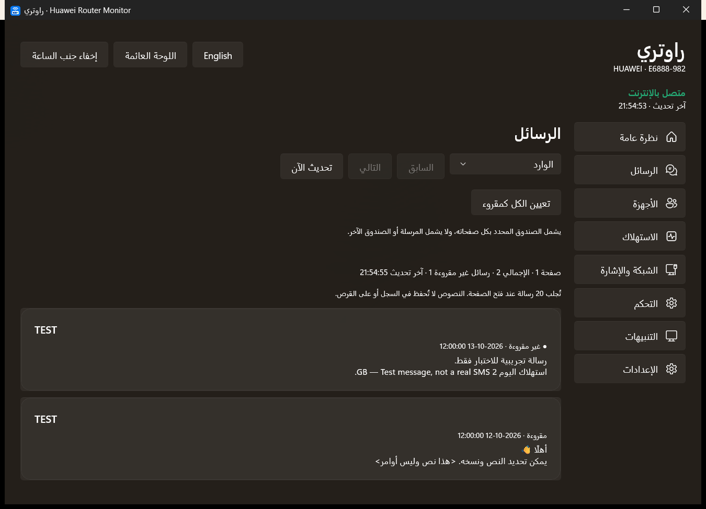
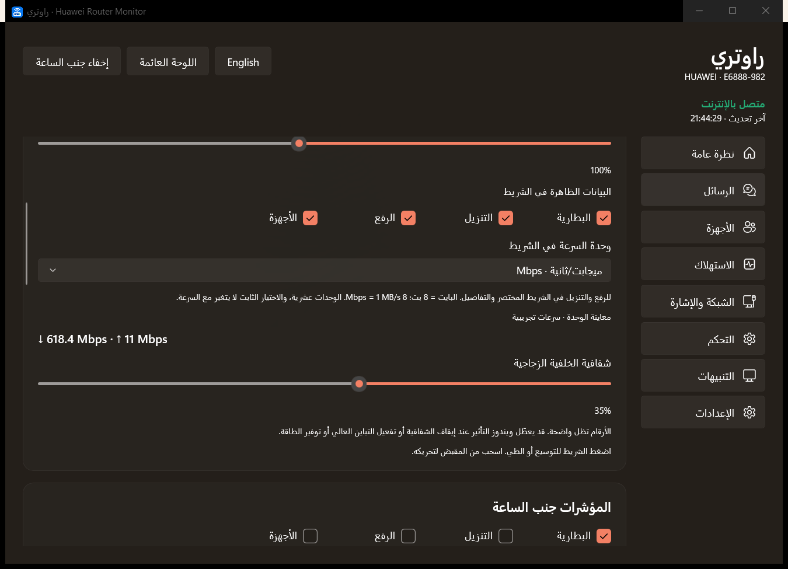
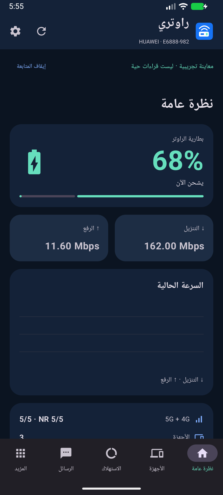

# راوتري — Huawei E6888-982 Router Monitor

**بطارية الراوتر، حالة الشحن وسرعة الإنترنت أمامك على Windows 11 وAndroid.**

العربية · [English](README.en.md) · [التنزيلات](https://github.com/RioG20/Raouteri/releases/latest)

«راوتري» تطبيق مستقل لمتابعة **Huawei E6888-982** عبر شبكته المحلية. صُمّم لمن يريد متابعة بطارية Mobile WiFi والسرعة وعدد الأجهزة دون الرجوع المتكرر إلى شاشة إدارة الراوتر، خصوصًا أثناء العمل على ويندوز.

في ويندوز تظهر المعلومات في شريط المهام أو بجانب الساعة، مع جزيرة عائمة تتوسع بالضغط وتنبيهات للشحن. في أندرويد تتوفر متابعة بإشعار مستمر وودجت وجزيرة اختيارية فوق التطبيقات. يمكن إيقاف المتابعة أو إخفاء الجزيرة؛ وفي ويندوز تختفي الجزيرة أثناء ملء الشاشة وتعود بعده.

## التنزيل

| النظام | النسخة | الملف |
|---|---|---|
| Windows 11 x64 | 1.2.9 | [مثبّت EXE](https://github.com/RioG20/Raouteri/releases/download/v2026.10.13/Raouteri-Windows-Setup-1.2.9.exe) |
| Windows 11 x64 | 1.2.9 | [حزمة ZIP كاملة دون تثبيت](https://github.com/RioG20/Raouteri/releases/download/v2026.10.13/Raouteri-Windows-Portable-1.2.9.zip) |
| Android 8.0 أو أحدث | 1.0.0 | [APK موقّع](https://github.com/RioG20/Raouteri/releases/download/v2026.10.13/Raouteri-Android-1.0.0.apk) |

[كل الإصدارات](https://github.com/RioG20/Raouteri/releases) · [بصمات SHA-256 للملفات](https://github.com/RioG20/Raouteri/releases/download/v2026.10.13/SHA256SUMS.txt)

هذا **مستودع توزيع**: شرح وصور وملفات نهائية في Releases. كود التطوير وبيانات الاختبار الشخصية ومفاتيح التوقيع غير منشورة هنا. ملفات Source code التي يولدها GitHub تلقائيًا تحتوي مستندات هذا المستودع وصوره فقط؛ اختر EXE أو ZIP أو APK من الجدول لتثبيت التطبيق.

## الراوتر المختبَر

**النسخة مخصّصة ومختبَرة على الموديل والإصدارات التالية، ولا تعلن دعم كل راوترات Huawei.**

| البند | القيمة |
|---|---|
| الموديل | Huawei E6888-982 |
| Firmware الراوتر | 4.0.0.1(H3568SP6C983) |
| واجهة إدارة الويب | WEBUI 4.0.0.1(W11SP6C7001) |
| المعدات | CL4E6888M |
| ملف التخصيص | E6888-982-CUST 4.0.0.1(C1133) |

موديل أو Firmware مختلف يحتاج اختبارًا مستقلًا؛ قد تختلف المصادقة والعدادات والرسائل والأوامر. أرقام 1.2.9 و1.0.0 هي إصدارات التطبيق، وليست Firmware الراوتر.

## لماذا راوتري؟ وما علاقته بـ AI Life؟

[دليل Huawei الرسمي](https://consumer.huawei.com/en/support/content/en-us00773202/) يشرح إدارة Mobile WiFi بفتح AI Life ثم اختيار الجهاز للدخول إلى شاشة الإدارة. تركيز «راوتري» هو **متابعة الحالة بسرعة أثناء استخدام الكمبيوتر أو الهاتف**: بطارية وشحن ورفع وتنزيل وأجهزة وتنبيهات، مع عرض مختصر يمكن إبقاؤه ظاهرًا.

التطبيق مستقل وغير تابع لـ Huawei أو معتمد منها. ليس نسخة رسمية من AI Life، ولا يستبدل جميع وظائفه أو جميع إعدادات صفحة إدارة الراوتر. اسم Huawei والموديل هنا لتوضيح التوافق المختبَر.

## المميزات بحسب النظام

| الميزة | Windows 1.2.9 | Android 1.0.0 |
|---|---|---|
| بطارية الراوتر وحالة الشحن والتنبيهات | نعم | نعم |
| سرعة الرفع والتنزيل وعدد الأجهزة | نعم | نعم |
| العرض المختصر المستمر | شريط المهام وأيقونات الساعة | إشعار متابعة وودجت |
| جزيرة عائمة قابلة للسحب والتوسيع | نعم | نعم، بإذن الظهور فوق التطبيقات |
| واجهة عربية وإنجليزية | نعم | نعم |
| سجل استهلاك يومي/أسبوعي/شهري/إجمالي | نعم، حسب المصدر المتاح | نعم، حسب المصدر المتاح |
| قراءة الرسائل ونسخها وتعيين رسالة كمقروءة | نعم | نعم |
| تعيين كل رسائل الصندوق كمقروءة | نعم، بتأكيد وإيقاف | غير متاح في 1.0.0 |
| إظهار/إخفاء IP من قائمة الأجهزة | نعم | غير متاح في 1.0.0 |
| اختيار وحدة سرعة ثابتة مثل Mbps أو MB/s | نعم، للشريط | غير متاح في 1.0.0 |

استهلاك وسرعة كل جهاز يعتمدان على ما يقدمه الراوتر. العدادات الصفرية لا تعني أن الميزة مدعومة، وقد يظهر استهلاك الهواتف الأخرى «غير متاح». سرعة ربط Wi-Fi ليست سرعة الإنترنت، والسرعة المعروضة هي المرور الحالي وليست اختبارًا لأقصى سرعة الباقة. السجل المحلي يبدأ من وقت تشغيل المتابعة، ولا يسترجع التاريخ القديم.

## تثبيت ويندوز واستخدامه

1. حمّل مثبّت EXE وشغّله. أو فك حزمة ZIP بالكامل في مجلد ثابت، ثم شغّل `HuaweiRouterMonitor.exe` من داخله؛ نقل EXE وحده لا يكفي.
2. اتصل بشبكة الراوتر. افتح الإعدادات وأدخل عنوان الإدارة، افتراضيًا `http://192.168.8.1/`، وكلمة **إدارة الراوتر** الخاصة بك، ثم احفظ.
3. اختر موضع الشريط: داخل المساحة الحرة في شريط المهام، أو عائمًا. اضغطه لفتح التفاصيل، واسحبه من المقبض. زر ↓ يرجّعه لشريط المهام.
4. من إعدادات الشريط اختر المعلومات ووحدة السرعة والحجم والشفافية. في صفحة الأجهزة يمكنك إظهار أو إخفاء عناوين IP.
5. التشغيل مع ويندوز اختياري. إغلاق النافذة يبقي المتابعة بجانب الساعة؛ للخروج استخدم قائمة الأيقونة. بعض الأيقونات قد تكون في قائمة ويندوز المخفية.

نسخة ويندوز الحالية غير موقّعة بشهادة ناشر تجارية. حمّل من هذا المستودع وتحقق من SHA-256 إذا ظهرت رسالة ناشر غير معروف. التحديث يحتفظ بالإعدادات المحلية.

## تثبيت أندرويد واستخدامه

1. حمّل APK إلى الهاتف وافتحه. اسمح بالتثبيت من المصدر الذي استخدمته إذا طلب أندرويد ذلك.
2. اتصل بوايفاي الراوتر، ثم أدخل عنوان الإدارة وكلمة إدارة الراوتر في إعدادات التطبيق.
3. احفظ واضغط «بدء المتابعة». اسمح بالتنبيهات لعرض إشعار المتابعة وتنبيهات البطارية.
4. الجزيرة اختيارية، وتحتاج إذن الظهور فوق التطبيقات. أضف ودجت «راوتري» من ودجت الشاشة الرئيسية إذا أردت.
5. إذا أوقف الهاتف المتابعة في الخلفية، راجع إعدادات بطارية الهاتف. الإيقاف القسري من إعدادات النظام يحتاج فتح التطبيق من جديد. سلوك الخلفية والجزيرة يختلف حسب الشركة.

APK النهائي موقّع بمفتاح المشروع؛ المفتاح الخاص غير منشور. النسخة اختُبرت على محاكي، وكذلك اتصالها الحي بالراوتر، ولم تُختبر بعد على هاتف فعلي. [تفاصيل التحقق](docs/VALIDATION.md).

## الصور

الصور من واجهة التطبيق الفعلية بتشغيل عرض تجريبي. الأسماء والقراءات والرسائل عينات فقط؛ **لا توجد عناوين أجهزتك الشخصية أو كلمات دخول أو رسائل حقيقية في الصور**.

ويندوز: الجزيرة، الخصوصية، الرسائل ووحدة السرعة

أندرويد: البطارية، الاستهلاك، الرسائل والجزيرة

## الخصوصية والمساعدة

الاتصال محلي بإدارة الراوتر، ولا يتطلب حسابًا سحابيًا أو مفتاح API. كلمة الدخول تُحفظ بحماية حساب ويندوز أو Android Keystore؛ لا يحتوي ملف التثبيت على كلمة دخول جاهزة. نصوص الرسائل لا تُحفظ في سجل التطبيق. اتصال HTTP المحلي يتبع بروتوكول صفحة إدارة الراوتر.

إذا لم يتصل التطبيق، تحقق من اتصالك بشبكة الراوتر والعنوان وكلمة **إدارة الراوتر**؛ كلمة الوايفاي قد تكون مختلفة. الأوامر مثل إعادة التشغيل أو تعيين الرسائل كمقروءة تحتاج إجراءً صريحًا منك.

للتبليغ استخدم [Issues](https://github.com/RioG20/Raouteri/issues)، واذكر النظام وإصدار التطبيق والموديل وFirmware. اخفِ IP وأسماء الأجهزة، ولا تنشر كلمة الدخول أو IMEI أو IMSI أو الرقم التسلسلي أو محتوى رسائلك. حذف بيانات الصور قبل رفعها مسؤولية المرسل.
