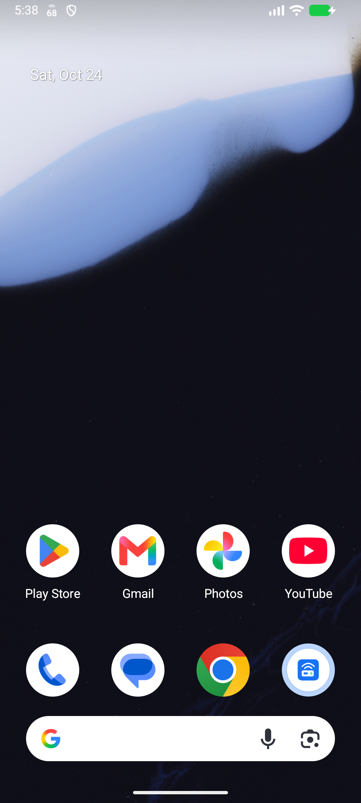
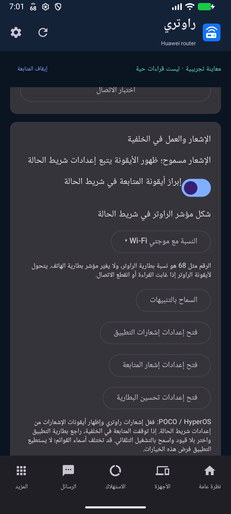
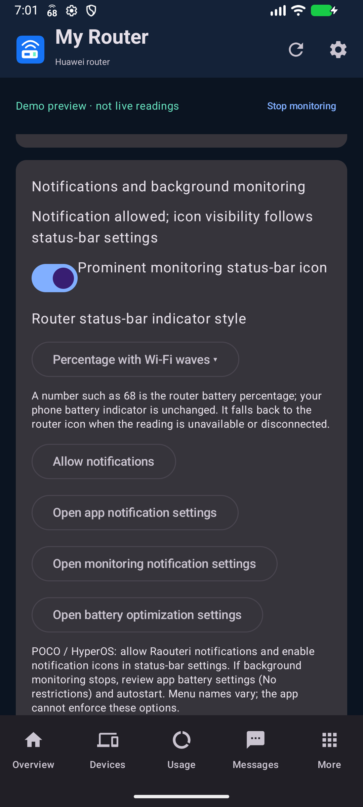

# أندرويد: نسبة بطارية الراوتر / Android router battery status

## العربية

**حل مؤكد بتجربة المستخدم على POCO F4 / HyperOS 1.00.15.0 Stable EU، بتاريخ 24 أكتوبر 2026:** إذا ظهر شعار راوتري بدل النسبة، افتح إعدادات الهاتف ← الإشعارات وشريط الحالة ← شريط الحالة، وعطّل **استخدام أيقونات التطبيقات للإشعارات / Use app icons for notifications**. هذا خيار مستقل عن نمط الإشعارات Android؛ تغيير النمط وحده لم يحل الحالة المبلّغ عنها. بعد تعطيله ظهر اختبار 68 لمدة 15 ثانية ثم عادت النسبة الحقيقية، كما أكد المستخدم عمل إيقاف المتابعة في 1.1.1. يغيّر الخيار طريقة أيقونات إشعارات الهاتف عمومًا، وقد تختلف تسميته أو إتاحته حسب النظام. لا يحتاج الحل APK جديدًا أو حذف البيانات. هذا تأكيد لهذه الحالة، وليس اختبارًا شاملًا لكل الهواتف.

تحديث 1.1.1 يستخدم أيقونات متجهة مدمجة بدل الصور المرسومة وقت التشغيل، مع تعبئة معرّف الأيقونة القديم والحديث. تغيير الأيقونات وحده لم يحل الحالة المبلّغ عنها؛ احتاج الهاتف تعطيل خيار استبدالها بشعار التطبيق كما سبق. نجاح المحاكي لا يضمن ظهوره على كل هاتف.

إذا كان إشعار راوتري موجودًا لكن الرقم غائب، أو يظهر شعار التطبيق مكانه:

1. من إعدادات راوتري ← الإشعار والعمل في الخلفية، فعّل إبراز الأيقونة واختر نمط النسبة.
2. اضغط **اختبار الرقم في شريط الحالة**: إشعار مستقل يعرض 68 لمدة 15 ثانية، وهي قيمة تجريبية وليست البطارية الحقيقية. لا يجلب بيانات ولا يغير إعدادات الراوتر.
3. إن ظهر إشعار الاختبار دون الرقم، اضغط «فتح إعدادات إشعارات التطبيق» وراجع إظهار الأيقونة لقناة راوتري. راجع أيضًا الحد الأقصى لعدد الأيقونات؛ ظهور واتساب وحده لا يثبت وجود مساحة لأيقونة أخرى. جرّب نمط Android للإشعارات إن كان متاحًا. تختلف الخيارات حسب الإصدار.
4. إذا ظهر رقم الاختبار واختفت النسبة الفعلية، أوقف المتابعة وابدأها، وراجع قراءة البطارية وخيار إبراز الأيقونة وقناة إشعار المتابعة. التطبيق يحذر عندما تكون القناة في وضع هادئ قد يخفي المؤشر.

لا يلزم حذف التطبيق أو مسح بياناته. ثبّت 1.1.1 فوق 1.1.0 بنفس التوقيع.

زر إيقاف المتابعة في التطبيق والإشعار يوقف التحديث التلقائي ويزيل الإشعار. تحديث 1.1.1 يمنع نموذج إعدادات قديمًا أو إجراء جزيرة قديمًا من تفعيلها مجددًا، ويلغي الطلب الجاري دون تنفيذ أوامر تحكم. فتح شاشة مثل الرسائل يدويًا يظل طلب قراءة صريحًا منك.

في Android 1.1.1 يظهر **رقم بطارية الراوتر نفسه** في خانة أيقونة إشعار «راوتري» أعلى الشاشة: `68` يعني 68%. لا تُضاف علامة % لضمان وضوح الرقم في المساحة الصغيرة. بطارية الهاتف الأصلية لا تتغير. موضع الرقم ولونه وعدد الأيقونات الظاهرة يحددها النظام. القراءة تتحدث أثناء المتابعة؛ عند تعذر الوصول للراوتر أو غياب قراءة صحيحة تعود أيقونة الراوتر. تفاصيل الشحن والسرعة موجودة داخل الإشعار.

1. ثبّت APK 1.1.1 فوق 1.0.0 دون حذف التطبيق. احفظ البيانات المحلية بالحفاظ على التطبيق وتوقيعه الأصلي.
2. اتصل بوايفاي الراوتر. من ملفات الاتصال أدخل العنوان واسم مستخدم الإدارة وكلمة الإدارة، واحفظ، ثم ابدأ المتابعة.
3. اسمح بإشعارات «راوتري» وقناة حالة الراوتر. من إعدادات التطبيق اترك إبراز الأيقونة وعرض نسبة بطارية الراوتر مفعّلين.
4. على POCO / HyperOS، إذا ظهر الإشعار عند السحب ولم يظهر الرقم أعلى الشاشة: ابحث في إعدادات النظام عن **إظهار أيقونات الإشعارات** ضمن الإشعارات وشريط الحالة، وراجع الحد الأقصى للأيقونات إن وُجد. المسميات تختلف حسب المنطقة والإصدار. مع مركز تحكم منفصل، اسحب من جانب الإشعارات.
5. إن توقفت المتابعة عند قفل الشاشة، افتح إعدادات بطارية التطبيق واختر «بلا قيود»، وراجع التشغيل التلقائي. يوفر التطبيق اختصارات لهذه الصفحات؛ لا يغيرها تلقائيًا.

الشكل الافتراضي «النسبة مع موجتي Wi-Fi»؛ الموجتان للتعريف بالراوتر وليستا قوة الإشارة. يمكن اختيار «النسبة فقط» أو «أيقونة الراوتر» من إعدادات التطبيق، وإيقاف المتابعة من الإشعار. اختيار المتابعة الهادئة قد يجعل النظام يخفي الأيقونة؛ أبقِ اختيار إبرازها مفعّلًا لعرض الرقم.

الاختبارات الآلية على محاكي Android 16؛ الهاتف الفعلي لم يكن متصلًا بأدوات التطوير. تأكيد المستخدم لظهور الرقم والاختبار والإيقاف موضح أعلاه، ولا يشمل اختبار الخلفية طويل المدة. لا يستطيع التطبيق تجاوز إخفاء الأيقونات أو قيود الخلفية التي يختارها النظام.

## English

**User-confirmed on POCO F4 / HyperOS 1.00.15.0 Stable EU, October 24, 2026:** if the Raouteri logo replaces the percentage, open phone Settings → Notifications & status bar → Status bar and disable **Use app icons for notifications**. This is separate from Android notification style; changing that style alone did not resolve this report. After disabling the option, the synthetic 68 appeared for 15 seconds and the real battery number returned. The user also confirmed that Stop monitoring works in 1.1.1. This system option affects notification icons across the phone; its name and availability vary. No new APK or data reset is needed. This confirms the reported case, not every handset.

Version 1.1.1 uses bundled vector resources instead of runtime bitmaps, populating modern and legacy notification icon IDs. The resource change alone did not resolve the reported handset case; disabling the system app-icon substitution option above did. Emulator success does not certify every handset.

If the drawer notification exists but its number is absent, or the app logo replaces it:

1. Enable the prominent icon and a percentage style in Raouteri notification settings.
2. Tap **Test the status-bar number**. A separate notification shows a synthetic 68 for 15 seconds. It does not poll or change your router, and is not the actual battery reading.
3. If the test drawer notification appears without a top number, review app/channel icon visibility and the system icon-count limit. Another app's visible icon does not prove there is room for an additional icon. Try Android notification style if your system provides it; options vary.
4. If the test number appears but the live number does not, restart monitoring and review the battery reading, prominence option and monitoring channel. The app warns about quiet/low-importance channels that may hide icons.

Install 1.1.1 over 1.1.0 without clearing data or uninstalling; the signing key is unchanged.

Stop monitoring in the app or notification ends automatic polling and removes the ongoing notification. 1.1.1 prevents stale settings/island actions from enabling monitoring again and cancels in-flight reads without sending router-control commands. Manually opening a screen such as SMS remains an explicit read request.

Android 1.1.1 draws the **router battery percentage** in Raouteri's notification icon slot at the top: `68` means 68%. The % sign is omitted to keep digits legible in the small slot. Your phone's battery indicator is unchanged. Android controls placement, tint and icon count. Monitoring updates the reading; disconnection or missing battery data restores the router glyph. Charging and traffic details remain inside the notification.

1. Install 1.1.1 over 1.0.0 without uninstalling. Keep the original app/signature to retain local data.
2. Connect to router Wi-Fi. Save the management address, administration username and password in a connection profile, then start monitoring.
3. Allow Raouteri notifications and its Router status channel. Keep the prominent-icon and router-battery-number settings enabled.
4. On POCO / HyperOS, if the drawer notification exists but its top number is absent, find **Show notification icons** under system notification/status-bar settings. Check any maximum icon-count setting. Names vary by region/version. With separate control-center panels, pull from the notification side.
5. If monitoring stops with the screen locked, review app battery settings (No restrictions) and autostart. The app provides shortcuts; these choices remain yours.

The default style is Percentage with Wi-Fi waves; the waves identify the router and do not measure signal strength. Settings also offers Percentage only and Router icon. You can stop monitoring from the notification. Quiet monitoring may hide status icons under system policy; keep prominence enabled for the number.

Automated checks used an Android 16 emulator; the physical handset was not connected to development tools. The user's confirmation of the number, temporary test and stop behavior is recorded above and does not cover long-running background reliability. App code cannot override system-wide status-icon or background restrictions.

Official references: [Xiaomi status-bar icons](https://www.mi.com/my/support/article/KA-33188/), [POCO F4 notification permissions](https://www.mi.com/fr/support/faq/details/KA-785217/), [Android notification permission](https://developer.android.com/develop/ui/compose/notifications/notification-permission).

Developer references: [Xiaomi small-icon guidance](https://dev.mi.com/xiaomihyperos/documentation/detail?pId=1582), [Android native small-icon resource API](https://developer.android.com/reference/android/app/Notification.Builder#setSmallIcon(int)). These describe supported APIs, not a guarantee of any particular HyperOS version's status-bar rendering.
