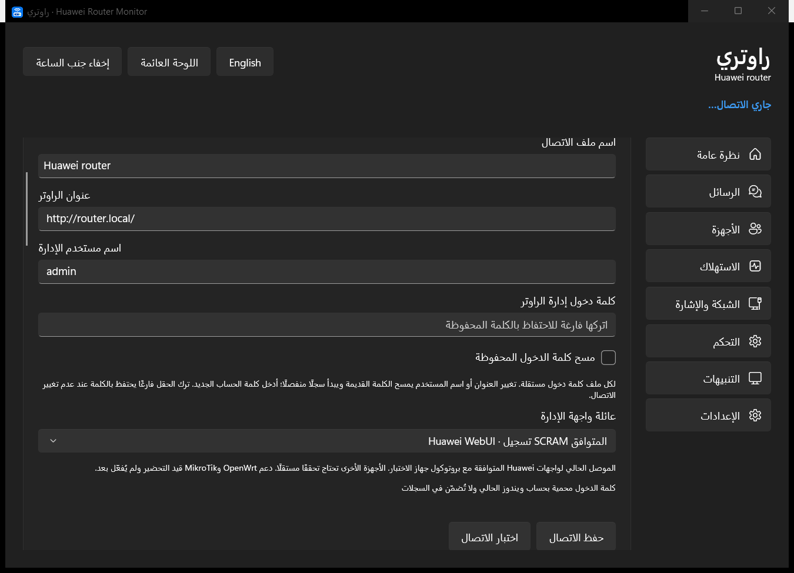
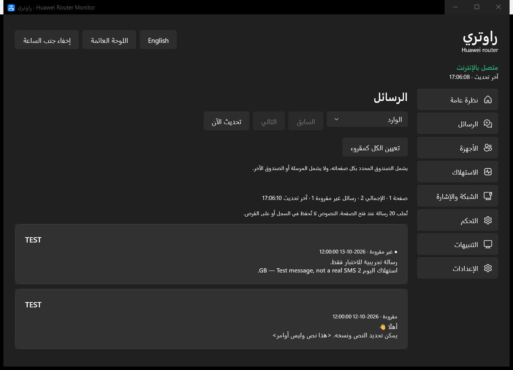

# ملفات الاتصال والتوافق / Connection profiles and compatibility

[العربية](#العربية) · [English](#english)

## العربية

هذه الإضافة في **Windows 1.3.1 فقط**. Android المنشور ما زال 1.0.0.

1. اتصل بشبكة الراوتر وافتح الإعدادات ← ملفات اتصال الراوترات.
2. اختر الملف الحالي أو «إضافة راوتر»، ثم سمّه وأدخل عنوان صفحة الإدارة واسم مستخدم الإدارة وكلمة الإدارة. كلمة الوايفاي قد تكون مختلفة.
3. اضغط «اختبار الاتصال» لاختبار القيم المدخلة دون تغيير إعدادات الراوتر. نجاح الحالة الأساسية وحدها لا يعني نجاح المصادقة؛ توضح الرسالة الفرق.
4. اضغط «حفظ الاتصال». اختر ملفًا آخر من القائمة للتبديل؛ التبديل يستخدم المحفوظ، لذا احفظ قبل الانتقال.

لكل ملف كلمة محمية بحساب ويندوز وسجل استهلاك وتنبيهات وأسماء أجهزة مستقلة. يبدأ التاريخ من المتابعة المحلية. عند تغيير العنوان أو الحساب تمسح الكلمة السابقة ويبدأ نطاق سجل جديد؛ أدخل كلمة الحساب الجديد. ترك خانة الكلمة فارغة يحتفظ بالمحفوظة فقط للاتصال غير المعدل. خيار المسح يزيل الكلمة المحفوظة. إزالة الملف لا تحذف ملفات سجله القديمة.

التحديث من النسخة القديمة يحتفظ بنفس كلمة الدخول المحمية والسجل والإعدادات؛ ينشئ نسخة محلية `settings.json.pre-profiles.bak` قبل الترحيل الأول. النسخة الاحتياطية محلية ولا تُرفَع. التثبيت أو ZIP لا يحتوي إعدادات المستخدم أو كلمات جاهزة.

عند غياب قراءة بطارية صحيحة تخفي لوحة ويندوز والجزيرة وأيقونات الساعة البطارية والشحن، ولا تصدر تنبيهات بطارية وهمية. هذا سلوك اختُبر ببيانات معزولة، وليس اعتمادًا لموديل راوتر منزلي آخر.

## English

This addition is in **Windows 1.3.1 only**. The published Android app remains 1.0.0.

1. Connect to the router network. Open Settings → Router connection profiles.
2. Select the current profile or Add router. Set its name, management-page address, administration username and administration password. The Wi-Fi password may differ.
3. Test connection probes the entered values without changing router settings. Basic status access is distinguished from authenticated access.
4. Save connection, then select another saved profile when needed. Switching activates saved values immediately; save edits first.

Each profile has an independently protected password, usage history, event history and device aliases. History begins with local monitoring. Changing the address or account clears the previous password and starts a separate history scope; enter the new account password. A blank password preserves the saved value only when the connection is unchanged. Clear stored password removes it. Removing a profile retains its old history files on disk.

Upgrading preserves the existing protected password, history path and preferences, and creates a local `settings.json.pre-profiles.bak` before the first migration. That backup stays local. Neither installer nor portable ZIP includes personal settings or preconfigured passwords.

When no valid battery reading is available, Windows dashboard/island/tray omit battery and charging indicators and avoid false battery alerts. This was checked with isolated fixtures; it does not certify a different mains-powered router model.

## التوافق / Compatibility

| Router family | Status |
|---|---|
| Huawei E6888-982: 4.0.0.1(H3568SP6C983), WebUI 4.0.0.1(W11SP6C7001) | Tested live / مختبَر حيًا |
| Other Huawei WebUI with compatible SCRAM | Configurable and testable; not independently validated / يحتاج اختبار الموديل والبرنامج |
| Different Huawei login families / ONT devices | Not assured; other authentication methods are not implemented |
| OpenWrt / MikroTik | Research only; no implemented connector / بحث فقط |
| ZTE / TP-Link / NETGEAR and other brands | Not implemented / غير منفّذ |

Adding a username and password is necessary for some devices, but each management protocol needs its own connector and validation. Unsupported interfaces are reported rather than treated as a successful login. Device identity reads retain only model/firmware/WebUI fields, not IMEI, IMSI or serial numbers.

Official research references: [Huawei management password](https://consumer.huawei.com/en/support/content/en-us15673981/), [OpenWrt ubus](https://openwrt.org/docs/guide-developer/ubus), [MikroTik REST API](https://manual.mikrotik.com/docs/developer-guides/rest-api/). These references inform future connector work; they do not establish current app support.

## استعادة الدخول / Sign-in recovery (Windows 1.3.1)

انتهاء جلسة القراءة يعيد المصادقة والتفاصيل مرة واحدة. الردود المؤقتة تنتظر دقيقة (خمس دقائق لرد كثرة المحاولات). رفض كلمة المرور أو قفل المحاولات يوقف التكرار الآلي؛ راجع الإعدادات أو انتظر مدة الحظر في صفحة الراوتر، ثم اضغط «إعادة الاتصال». لا تضغطه بصورة متكررة أثناء الحظر. الكلمة والسجل لا يتغيران. تعود صفحة الرسائل تلقائيًا بعد استعادة المصادقة.

An expired read session gets one fresh login and detail retry. Temporary refusals wait 60 seconds (five minutes for the frequent-login response). Credential rejection or lockout stops automatic login attempts. Check Settings or wait for the router's stated lockout period, then use Reconnect; do not repeatedly press it during a lockout. Saved credentials/history remain intact. SMS reloads when authentication recovers.

